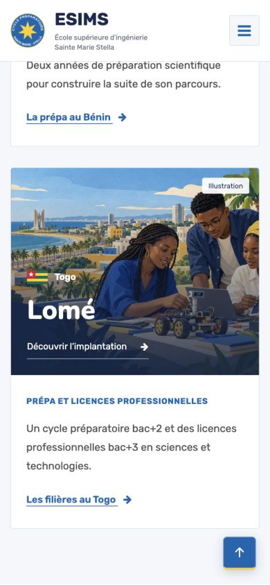
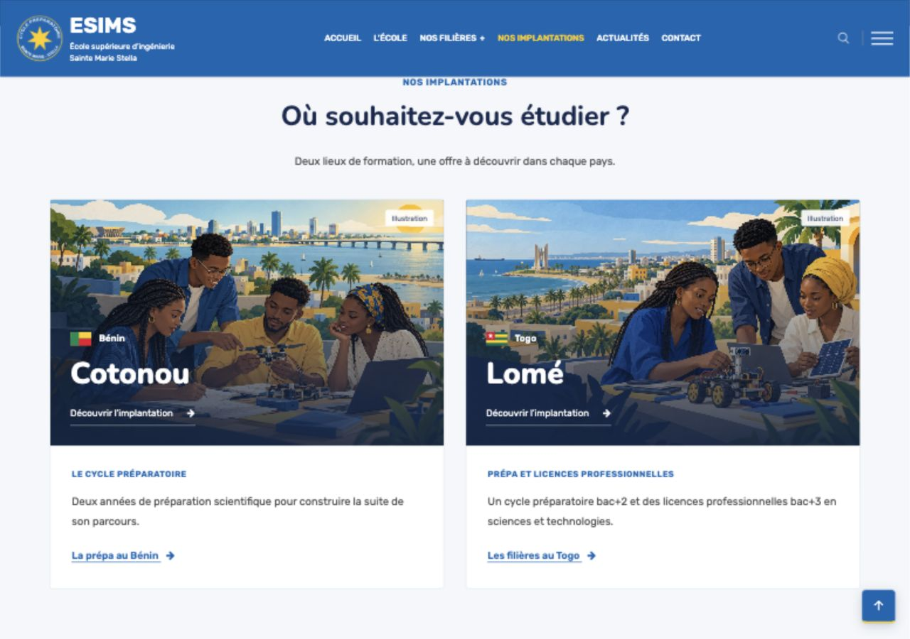

# Corrections mobile — 23 octobre 2026

- En-tête désormais `fixed` sous 992 px, avec une réservation de 88 px dans la page. Les réglages `overflow-x: hidden` de certains modèles ne peuvent plus faire disparaître le menu lors du défilement.
- Hamburger et croix seuls, dans une cible tactile de 44 × 44 px, avec libellés accessibles. La couleur de l’icône reste bleue sur l’en-tête clair après défilement et blanche sur le bouton de fermeture bleu.
- Barre des rubriques des filières et filtres d’actualités positionnés sous l’en-tête fixe. Les ancres conservent un dégagement adapté.
- Ancien élément `#scrollUp` remplacé au rendu par un vrai bouton commun `#esims-scroll-top` : cible de 48 × 48 px, contraste bleu/blanc et accent jaune, position compatible avec les zones de sécurité du téléphone, apparition après 320 px.
- Défilement natif vers le haut sans queue d’animations jQuery ; bouton utilisable au clavier ; mouvement réduit respecté.
- Menu ouvert : arrière-plan inactif, retour en haut masqué ; fermeture par Échap, clic extérieur, croix et navigation conservée.
- Deux illustrations générées et intégrées sur les cartes des implantations. Sources et prompts : `IMPLANTATIONS-ILLUSTRATIONS.md`.

## Contrôles

En-tête au bord supérieur après défilement et absence de débordement horizontal contrôlés sur accueil, école, actualités, article, FAQ, inscriptions, contact, prépa Bénin et implantations. Navigation du menu et retour en haut contrôlés sur mobile ; version ordinateur conservée.

Les contrôles de liens, médias et modèles passent. Build : 161 pages générées. Le premier essai s’est arrêté sur l’avertissement de sécurité de Next.js 16.4.0 ; la relance réussit et conserve cet avertissement. La mise à jour de sécurité reste à traiter, sans modification de dépendances dans cette correction.

## Espacement et contraste du hamburger

La règle responsive Educavo affectait aussi la couleur du bouton parent en état `sticky` : une icône héritant de cette couleur devenait blanche. Une règle explicite, plus spécifique et limitée au bouton fermé, maintient désormais le bleu `#0066B3`. La croix reste blanche sur le bouton bleu quand le panneau est ouvert.

Contrôle navigateur sur Actualités : bouton, icône et pseudo-élément bleus après défilement, puis à nouveau bleus après ouverture et fermeture du panneau. Espacement entre les entrées ordinateur : 16 px à 1024 px, 22 px à 1280 px et 26 px à 1440 px ; les six entrées restent sur une ligne sans débordement. Les lignes du menu mobile gagnent 2 px de marge intérieure en haut et en bas.

