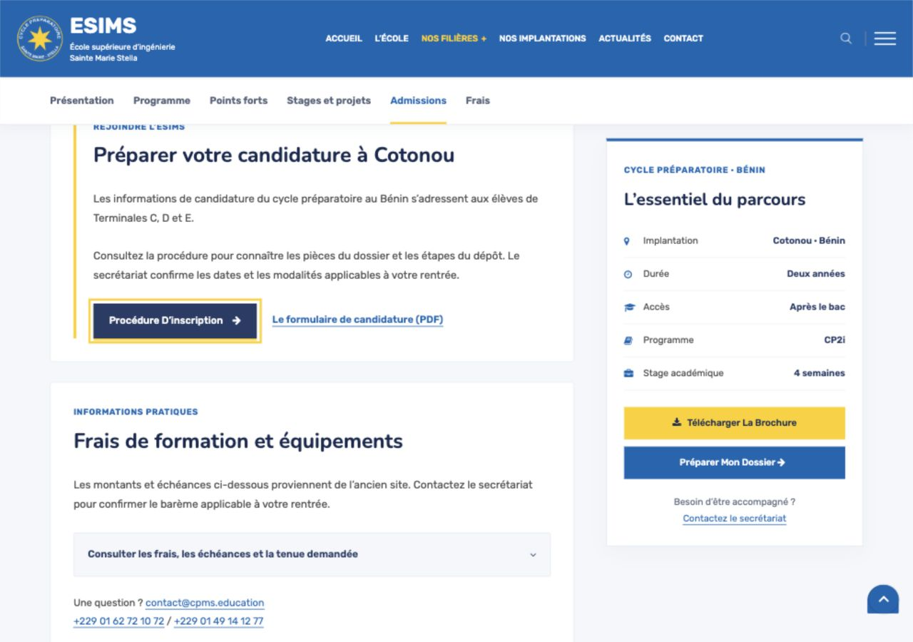

# Navigation harmonisée — 23 octobre 2026

Les menus, pieds de page, liens de contenu, boutons et résultats de recherche utilisent les destinations retenues. Les anciennes adresses redirigent vers les pages actuelles.

| Ancienne entrée | Destination |
| --- | --- |
| Présentation | L’École |
| Partenaires | L’École, section des écoles partenaires |
| Admissions | Inscriptions / S’inscrire |
| Cycle ingénieur | Accueil, parcours après le bac |
| Domaines | Nos filières |
| Galerie | Événements |

Les anciennes URL WordPress et les doubles entrées institutionnelles dans les articles suivent les mêmes destinations. Les documents PDF, coordonnées, photos et liens vers les partenaires restent accessibles.

Les six domaines ne nécessitent aucune pagination : les trois liens de démonstration vers la page d’erreur ont été supprimés. Les liens de texte sont soulignés, les boutons gardent un contraste blanc sur bleu foncé au survol ou au clavier, avec un repère jaune. Les sections des fiches de formation se positionnent sous les deux barres fixes.

Validation :

- `npm run verify:links` : 103 pages, 7 944 liens internes, 347 ancres, 69 redirections ; aucune destination absente, ancienne ou de secours.
- Build Next.js réussi, 161 pages générées.
- 51 modèles et 634 fichiers Educavo originaux intacts ; 281 médias/documents présents.
- Vérifications navigateur : quatre anciennes URL redirigées, parcours depuis L’École, bouton de procédure d’inscription, résultats de recherche, rendu ordinateur et mobile, focus clavier visible.

Contrôle reproductible : `npm run verify:links`.

