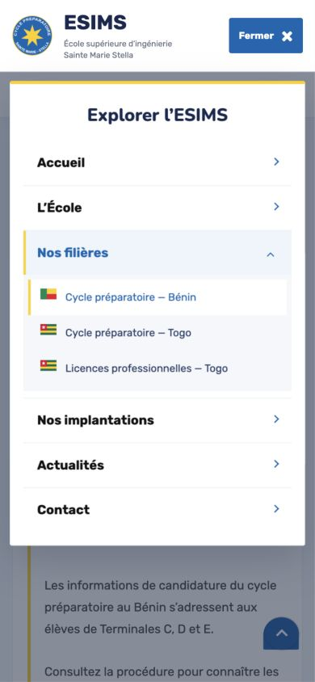

# Préparation de la revue client — 23 octobre 2026

Les pages principales sont en place : accueil, école, trois filières, implantations, actualités/événements, lecture des articles, contact et FAQ. Les liens internes et anciennes adresses ont été harmonisés. La version peut servir à une première validation graphique et éditoriale.

## Points restant à valider pour finaliser

| Sujet | Éléments attendus |
| --- | --- |
| Implantation de Lomé | Adresse précise, contacts locaux, horaires et photographies du site ; les illustrations actuelles provenant du Bénin sont signalées comme telles. |
| Prépa et licences au Togo | Filières effectivement ouvertes, enseignements détaillés, conditions d’accès, calendrier, frais, stages et débouchés confirmés par l’école. L’agrément seul ne renseigne pas toutes ces modalités. |
| Inscriptions et documents | Actualité du calendrier 2026–2027 et des tarifs hérités du site CPMS ; validation de la brochure et du formulaire PDF pour la présentation ESIMS. |
| Contact et newsletter | Le contact prépare un email à envoyer depuis la messagerie du visiteur. L’envoi direct par le site et l’abonnement à la newsletter ne sont pas connectés. Définir puis brancher les services souhaités. |
| Consultation à distance | Publier la version actuelle sur une URL de prévisualisation et transmettre ce lien au client. Aucune publication ni aucun push n’a été effectué pour cette modification. |

Les contenus WordPress sont importés localement ; la mise à jour éditoriale n’utilise pas encore un back-office connecté. Ce choix peut être traité après la validation des pages.

## Menu mobile

- Bandeau email/téléphones et boutons supérieurs masqués sous 992 px.
- En-tête de 88 px avec logo et bouton Menu/Fermer.
- Panneau blanc, couleurs Educavo/ESIMS, filières dépliables avec drapeaux et état actif lisible.
- Fermeture par bouton, clic extérieur, Échap ou navigation ; parcours clavier circonscrit au menu ouvert.
- Arrière-plan inactif et défilement bloqué pendant l’ouverture.
- Vérifications à 320 et 390 px, ouverture après défilement dans une fiche, navigation vers Contact et conservation de l’en-tête ordinateur à 1280 px.
- Build et TypeScript validés ; 103 pages et 7 944 liens internes contrôlés ; modèles Educavo originaux intacts.

