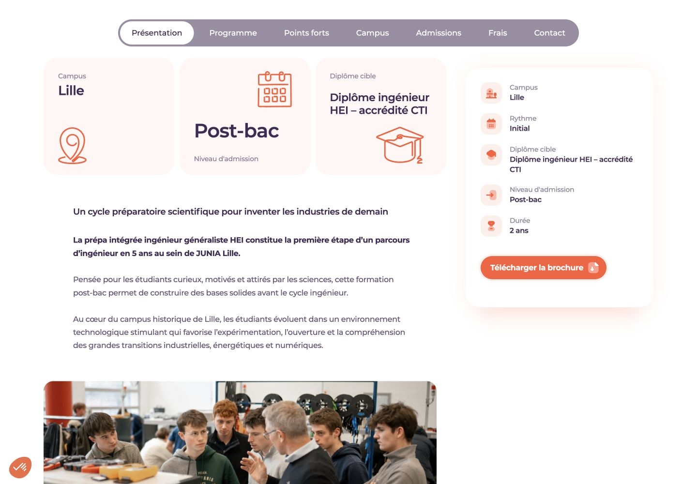
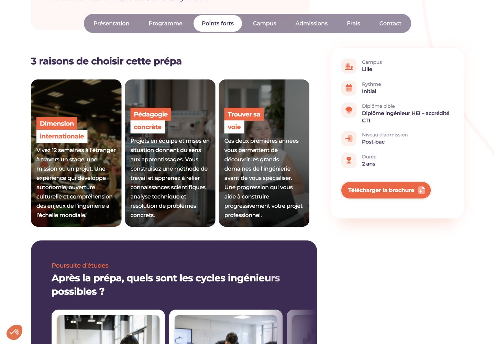
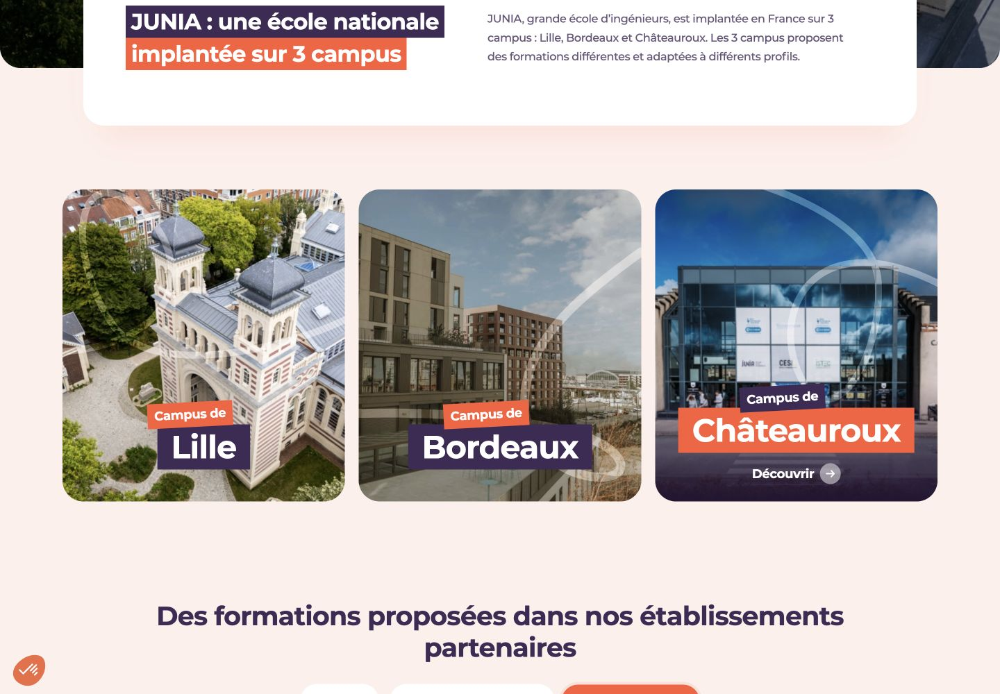
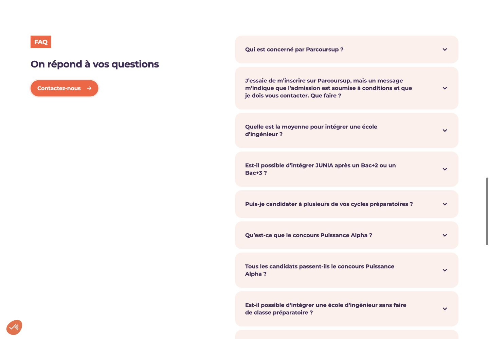

# Références JUNIA pour les pages ESIMS

Sélection du 22 octobre 2026. Captures réelles du site JUNIA, destinées à comparer les mises en page. Ces propositions ne sont pas encore intégrées au site ESIMS.

La ligne commune proposée reste celle d’Educavo : typographies et espacements actuels, bleu #0066B3, jaune #FFCF03, bleu nuit, boutons rectangulaires, photos de l’ESIMS. Les dispositions ci-dessous sont des pistes d’adaptation, pas des modèles Educavo déjà prêts à l’identique.

## 1. L’École : présentation photographique

[Page source JUNIA](https://www.junia.com/junia-ecole-ingenieurs/), première section de présentation après la bannière.

Une photographie occupe une colonne ; le titre, deux paragraphes et un bouton occupent l’autre. C’est une façon lisible d’introduire l’identité de l’établissement.

**Pour ESIMS :** présenter l’école puis expliquer la place du cycle préparatoire, avec les offres distinctes au Bénin et au Togo. Réutiliser la structure de la première section `#rs-about` d’[about2.html](http://127.0.0.1:3003/about2.html), déjà choisie. Ajouter ensuite les reconnaissances propres à chaque pays et les partenaires. Un mot de la direction serait possible si un texte approuvé et un portrait sont fournis.

## 2. Fiches de filières : navigation et informations pratiques

[Page source JUNIA](https://www.junia.com/formations/cycle-preparatoire-integre-ingenieur-hei-generaliste/), début du contenu après la bannière.

Le résumé latéral et la navigation entre les parties facilitent la lecture d’une fiche longue.

**Pour ESIMS :** un même gabarit pour les deux prépas et les licences, avec pays, ville, durée, niveau d’accès, programme, admission et brochure. Partir des onglets et de la colonne latérale de [course-single.html](http://127.0.0.1:3003/course-single.html). Conserver le tableau des matières et coefficients demandé ; ne pas ajouter de filtres complexes pour seulement trois offres.

## 3. Fiches de filières : trois atouts illustrés

[Même page source JUNIA](https://www.junia.com/formations/cycle-preparatoire-integre-ingenieur-hei-generaliste/), section des points forts.

**Pour ESIMS :** trois cartes compactes pour les fondamentaux scientifiques, les travaux pratiques et l’accompagnement. Reprendre les cartes photographiques déjà présentes dans l’accueil, avec moins de texte superposé. La poursuite chez les partenaires peut être présentée dans une section distincte, avec ses conditions d’admission.

## 4. Nos implantations : deux lieux clairement identifiés

[Page source JUNIA](https://www.junia.com/nos-campus/), cartes des campus sous la présentation.

**Pour ESIMS :** deux grandes cartes Cotonou / Bénin et Lomé / Togo avec drapeaux et filières disponibles. Au clic, afficher les informations pratiques de l’implantation. Adapter les cartes photographiques Educavo déjà utilisées sur l’accueil. Pour Lomé, il reste à obtenir une photo réelle des lieux, l’adresse et les coordonnées locales ; ne pas présenter une photo du Bénin comme celle du campus togolais.

## 5. Inscriptions : guider vers la bonne procédure

[Page source JUNIA](https://www.junia.com/admission-inscription/), choix du parcours et bloc d’accompagnement à la candidature.

**Pour ESIMS :** remplacer les nombreux filtres par trois choix simples : prépa Bénin, prépa Togo, licences Togo. Afficher ensuite les conditions connues, les pièces, le dépôt du dossier et le contact. Utiliser les onglets Educavo et une présentation numérotée des démarches. Les dates, tarifs et exigences du Bénin ne sont pas automatiquement applicables au Togo.

## 6. FAQ : questions à droite, aide à gauche

[Page source JUNIA](https://www.junia.com/admission-inscription/), section FAQ après les concours.

**Pour ESIMS :** un court texte avec le contact du secrétariat à gauche, les questions à droite. Réutiliser les accordéons de [faq.html](http://127.0.0.1:3003/faq.html). Les questions seraient propres à l’ESIMS : choisir son pays, accéder à la prépa, préparer son dossier, poursuivre chez un partenaire. Une FAQ courte peut conclure les fiches ; la page complète reste accessible depuis le footer.

## 7. Contact : orienter la demande

[Page source JUNIA](https://www.junia.com/contact/), première rangée de cartes.

**Pour ESIMS :** trois sujets seulement — admission, choix de filière, renseignements pratiques — qui présélectionnent le motif d’un formulaire commun. Conserver la base de [contact4.html](http://127.0.0.1:3003/contact4.html), la phrase de localisation validée et les coordonnées réelles. Ce serait un ajout facultatif : il faut garder la page courte.

## Ordre recommandé

1. Valider la page L’École : introduction, identité, reconnaissances par pays, pédagogie, partenaires, témoignage, FAQ.
2. Définir un gabarit de fiche filière, puis l’appliquer aux trois offres.
3. Compléter Nos implantations, particulièrement les informations de Lomé.
4. Revoir les inscriptions en séparant pays et filières.
5. Ajuster FAQ et Contact. Conserver pour les actualités les modèles `blog-left.html` et `blog-post-left.html` déjà retenus.

Les textes, reconnaissances et chiffres de JUNIA ne constituent pas des informations sur ESIMS. Les photos des captures sont des références visuelles ; les pages ESIMS doivent utiliser leurs propres contenus.
